<p align="center">
  
</p>

<p align="center">
  <b>A Battleship engine that weighs every possible fleet on every shot.</b><br>
  Rust · exact Bayesian inference · endgame search · learns its opponent · plays in the browser
</p>

<p align="center">
  <a href="#play-it">Play it</a> ·
  <a href="#how-it-works">How it works</a> ·
  <a href="#how-strong-is-it">How strong is it</a> ·
  <a href="#commands">Commands</a> ·
  <a href="#roadmap">Roadmap</a>
</p>

---

<table>
<tr>
<td align="center" width="25%"><h3>44.0</h3>mean shots to sink a random fleet</td>
<td align="center" width="25%"><h3>30,093,975,536</h3>fleet layouts, all counted on every turn</td>
<td align="center" width="25%"><h3>~45 ms</h3>the full posterior of an empty board, one core</td>
<td align="center" width="25%"><h3>0.8</h3>shots per game better than the classic density bot</td>
</tr>
</table>

## Play it

**In the browser.** The whole engine compiles to WebAssembly and runs inside one self-contained page,
no server needed:

```sh
web/build.sh                  # builds web/dist/broadside.html
open web/dist/broadside.html
```

Place your fleet (or roll a random one), win the coin toss, and fire. The engine learns through the
session where you hide ships and which waters you search last, so later games get harder.
Tick *Show where the engine expects your ships* to watch it think.

**In the terminal.**

```sh
cargo run --release -p broadside -- play --heat   # you vs the engine
cargo run --release -p broadside -- assist        # the engine calls your shots against anyone else
```

### Rules

Standard 10×10 board. Fleet: Carrier 5, Battleship 4, Cruiser 3, Submarine 3, Destroyer 2. Ships lie
horizontally or vertically, may touch, may not overlap. Each shot reports miss, hit, or *sunk* with
the ship's name. A hit alone does not say which ship it struck.

## How it works

<table>
<tr><td width="30%"><b>Exact inference</b></td><td>
Every layout consistent with the misses, hits and sinking reports (which ship sank, and when) is
counted exactly. Sunk ships are enumerated, hits are assigned to afloat ships by exact-cover search,
and ships touching no hit are counted in closed form with popcounts: all pairs minus overlapping
pairs. All 30 billion layouts of an empty board, with exact per-cell odds, take about 45 ms on one
core. Early positions are cached up to board symmetry.
</td></tr>
<tr><td><b>Shooting</b></td><td>
Fire at the likeliest cell until the ships still afloat have few enough joint placements to list
(200,000 by default; every position with two ships left has fewer than 30,000). From there the
engine searches. Each listed placement is a possible world, and a later position is just the subset
of worlds that agree with the shots since, so whole lines of play are judged by splitting lists,
with no further inference. The likeliest shots are compared by playing each to the end in every
world; positions with few worlds left are solved outright.
</td></tr>
<tr><td><b>A certain hit is not always right</b></td><td>
A cell can be sure to hold a ship while it is unclear which ship. Hitting it changes which later shot
announces which sinking, and that can cost information. The engine takes a certain hit without
thinking only when the same ship holds that cell in every layout; otherwise the search decides.
</td></tr>
<tr><td><b>Placement</b></td><td>
Tilted layouts: placements weighted per cell so ship occupancy hits a target between uniform and an
inverted centre bias. Shooters that assume uniform placement hunt the centre first and pay for it.
A single game uses an equilibrium mix of tilts, computed from the placement-game matrix, so even a
shooter that expects it cannot exploit it. (An equilibrium of the measured matrix of tilts against
shooters expecting a tilt, not of Battleship as a whole.)
</td></tr>
<tr><td><b>Learning across a match</b></td><td>
The shooter learns the opponent's placement habits by model selection (uniform, the tilt family,
shrunk per-cell occupancy, each scored on predicting the next revealed fleet), so it gains against
biased placers and loses nothing against uniform ones. The placer tracks where the opponent looks
last, and a bandit decides how hard to exploit it. Both learn only from what a real game shows: the
fleet revealed at the end, and the shots actually fired before the game ended.
</td></tr>
</table>

## How strong is it

Mean shots to sink a uniformly placed fleet, 100,000 games each unless noted:

| Shooter | Mean shots | |
|---|---:|---|
| random | 95.4 | |
| hunt-target | 59.6 | |
| parity (checkerboard hunting) | 50.8 | |
| density (the classic probability-density bot) | 44.8 | |
| greedy (exact posterior, no search) | 44.60 ± 0.03 | 0.1 ms/game |
| broadside, search up to 30,000 placements | 44.15 ± 0.03 | 4.6 ms/game |
| **broadside, default: up to 200,000 placements** | **about 44.04** | 38 ms/game |

The default was measured against the 30,000 setting on the same 20,000 layouts: 0.11 ± 0.04 shots
better. Times are per game on a 24-core machine running one game per core. Single games swing by
about ±8.6 shots (one standard deviation), so one game between two good players is mostly luck;
a match is not.

<details>
<summary><b>What the measurements say about the search</b></summary>

- **Reach is what pays.** Each step in how many placements the search will list (400, 3,000, 30,000,
  200,000) saved about another 0.1 shots; the cost grows about as fast as the limit.
- **Solving small positions optimally changes almost nothing.** With up to 24 placements left it
  altered the result of 135 games in 20,000 and the mean by 0.000 ± 0.001. Comparing shots by greedy
  play to the end is already close to optimal there. The solver stays on for the smallest positions,
  where it is free and its answers are provably right.
- **Thinking again at every later position helps, at a price.** With `deep=300` (lines of play
  through positions of up to 300 placements try the likeliest cells again instead of playing
  greedily) the 30,000 setting gained 0.07 ± 0.03 shots for ten times the time. Off by default.
- **Searching earlier does not pay.** With three ships afloat and too many placements to list,
  searching over 4,000 sampled placements (`afloat=3`) changed the mean by −0.01 ± 0.03 shots
  (1,000 samples: −0.02 ± 0.02), on 10,000 games each.
- **Playing for the win does not pay either.** With `race=16` the engine estimates how many shots the
  opponent still needs (rollouts of its play against our real fleet) and, while the race is open,
  picks the shot most likely to finish first. Against the plain engine, over 40,000 games each, it
  won 49.78%, 49.73% and 49.78% (± 0.25) for opponent spreads of 0, 1.5 and 3 shots, while needing
  0.2 more shots per game. Games between strong shooters are rarely decided by a shot that trades
  expected shots for variance.
- **A mean below 40 is not in sight.** From no search to the deepest search measured is 0.56 shots,
  and each further step costs about seven times the last one's time for a tenth of a shot.

</details>

<details>
<summary><b>Head-to-head matches</b> (older measurements)</summary>

`broadside` with its own placement, matches of 100 games so both sides may learn. Measured before the
search rewrite and under the old match rules, in which a placer saw every shot the opponent would
have fired, also after the game was over. A rerun under the current rules is pending.

| Opponent | Broadside wins |
|---|---:|
| density, uniform placement | 64.5% |
| density, edge-heavy placement | 72.0% |
| density, no-touch placement | 65.3% |
| greedy exact shooter, uniform placement | 60.6% |
| broadside without learning, uniform placement | 61.1% |
| broadside (self-play) | 49.9% |

</details>

## Commands

```sh
broadside play [--heat]          # you vs the engine; --heat shows its read of your fleet
broadside assist                 # engine advises shots vs any opponent; you report results
broadside sim --shooter S --placer P --games N     # shots-to-win statistics (--dump FILE: every game as CSV)
broadside compare A B [--placer P]                 # two shooters on the same layouts, game by game
broadside duel A B [--placer-a P] [--placer-b P]   # head-to-head win rate (--match N: both sides learn;
                                                   #   --dump FILE: shots-to-win histograms as CSV)
broadside analyze --shooter S    # where the misses happen (hunt vs target, by ships afloat)
broadside matrix --alphas 0,1,2  # placement game: tilted placers vs shooters expecting them
broadside bench                  # time the exact posterior and the engine's moves
broadside count                  # brute-force count of all 30,093,975,536 layouts
```

Run with `cargo run --release -p broadside -- <command>`.

- **Shooters:** `broadside`, `greedy`, `density`, `NAME@tiltA`, `parity`, `hunt-target`, `random`, and
  `broadside:KEY=N,...` to tune the search (`exact`, `cands`, `solve`, `nodes`, `deep`, `afloat`,
  `samples`, `race`, `spread`; see `Search` in `crates/core/src/ai/engine.rs`).
- **Placers:** `broadside`, `equilibrium`, `uniform`, `spaced`, `tiltA`, `mix:A=P,...`.
- **Tests:** `cargo test`, slow ones with `cargo test --release -- --ignored`.

## Project layout

```
crates/
  core/   broadside-core: rules, bitboards, inference, search, placement (pure logic, no I/O)
  cli/    broadside: the command-line front end
  wasm/   broadside-wasm: the engine for the browser, a plain C ABI over WebAssembly
web/      the browser game (page.html + build.sh → dist/broadside.html)
assets/   logo and banner (make_logo.py draws them)
```

Boards are `u128` bitboards, bit `row * 10 + col`. Release builds use fat LTO and `target-cpu=native`.
The core has no dependencies.

## Roadmap

- [x] Rules engine, baseline AIs, exact probability density, simulator, playable CLI
- [x] Endgame search, placement game, opponent modelling across a match
- [x] WebAssembly build and a browser UI
- [ ] An exact prior-weighted posterior before the search starts
- [ ] A shooter that tracks a mixed placer within a game
- [ ] Tests against outside engines and human players
- Tried, no gain measured (kept behind settings, off by default): search over sampled placements
  before the afloat ships can be listed (`afloat=N`), race-aware shooting (`race=N`)

## Reference numbers

| | |
|---|---|
| Positions per ship (5/4/3/3/2) | 120 / 140 / 160 / 160 / 180 |
| Fleet layouts, Cruiser ≠ Submarine | 30,093,975,536 |
| Fleet layouts, the two 3-ships interchangeable | 15,046,987,768 |
| Minimum possible shots | 17 |

<p align="center"></p>
