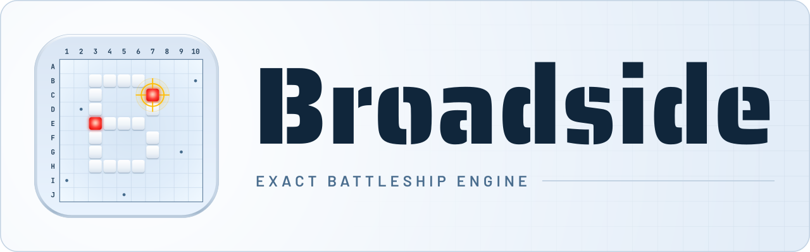
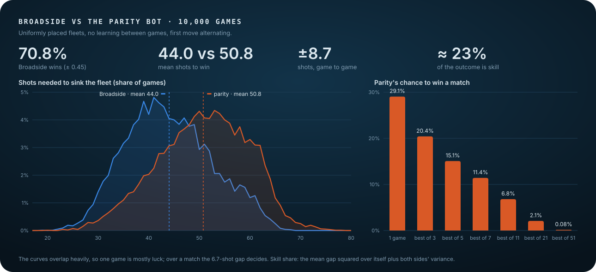
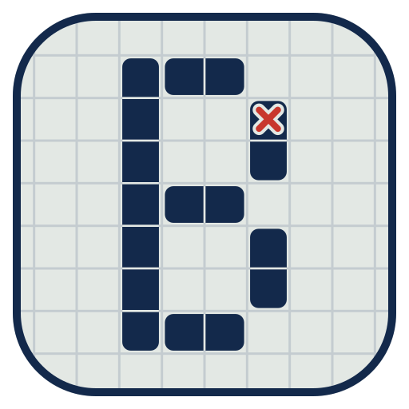

<p align="center">
  <picture>
    <source media="(prefers-color-scheme: dark)" srcset="assets/banner-dark.svg">
    
  </picture>
</p>

<p align="center">
  <b>A Battleship engine that weighs every possible fleet on every shot.</b><br>
  Rust · exact Bayesian inference · endgame search · learns its opponent · plays in the browser
</p>

<p align="center">
  <a href="#play-it">Play it</a> ·
  <a href="#how-it-works">How it works</a> ·
  <a href="#how-strong-is-it">How strong is it</a> ·
  <a href="#commands">Commands</a> ·
  <a href="#roadmap">Roadmap</a>
</p>

---

<table>
<tr>
<td align="center" width="25%"><h3>44.0</h3>mean shots to sink a random fleet</td>
<td align="center" width="25%"><h3>30,093,975,536</h3>fleet layouts, all counted on every turn</td>
<td align="center" width="25%"><h3>~45 ms</h3>the full posterior of an empty board, one core</td>
<td align="center" width="25%"><h3>0.8</h3>shots per game better than the classic density bot</td>
</tr>
</table>

## Play it

**Online:** play at [broadside.admingod.ch](https://broadside.admingod.ch), or download the command-line
engine for macOS, Windows or Linux from the [latest release](https://github.com/AdminGodZ/Broadside/releases/latest).

**In the browser.** The whole engine compiles to WebAssembly and runs on your device, no server
needed. The game is the website's `/play` page; the build also folds it into one self-contained file
that works offline (the site's *Save it for offline play*):

```sh
cd site && npm ci && npm run build   # dist/play/ for the site, dist/broadside.html offline
open dist/broadside.html
```

Place your fleet (or roll a random one), win the coin toss, and fire. The engine learns through the
session where you hide ships and which waters you search last, so later games get harder.
Tick *Show where the engine expects your ships* to watch it think.

**In the terminal.**

```sh
cargo run --release -p broadside -- play --heat   # you vs the engine
cargo run --release -p broadside -- assist        # the engine calls your shots against anyone else
```

### Rules

Standard 10×10 board. Fleet: Carrier 5, Battleship 4, Cruiser 3, Submarine 3, Destroyer 2. Ships lie
horizontally or vertically, may touch, may not overlap. Each shot reports miss, hit, or *sunk* with
the ship's name. A hit alone does not say which ship it struck.

## How it works

<table>
<tr><td width="30%"><b>Exact inference</b></td><td>
Every layout consistent with the misses, hits and sinking reports (which ship sank, and when) is
counted exactly. Sunk ships are enumerated, hits are assigned to afloat ships by exact-cover search,
and ships touching no hit are counted in closed form with popcounts: all pairs minus overlapping
pairs. All 30 billion layouts of an empty board, with exact per-cell odds, take about 45 ms on one
core. Early positions are cached up to board symmetry.
</td></tr>
<tr><td><b>Shooting</b></td><td>
Fire at the likeliest cell until the ships still afloat have few enough joint placements to list
(200,000 by default; every position with two ships left has fewer than 30,000). From there the
engine searches. Each listed placement is a possible world, and a later position is just the subset
of worlds that agree with the shots since, so whole lines of play are judged by splitting lists,
with no further inference. The likeliest shots are compared by playing each to the end in every
world; positions with few worlds left are solved outright. While it hunts with the two-cell ship
still afloat, its shots keep to a smallest set of cells that touches every place that ship can be
(<a href="#hunting-the-smallest-ship">below</a>).
</td></tr>
<tr><td><b>A certain hit is not always right</b></td><td>
A cell can be sure to hold a ship while it is unclear which ship. Hitting it changes which later shot
announces which sinking, and that can cost information. The engine takes a certain hit without
thinking only when the same ship holds that cell in every layout; otherwise the search decides.
</td></tr>
<tr><td><b>Placement</b></td><td>
Tilted layouts: placements weighted per cell so ship occupancy hits a target between uniform and an
inverted centre bias. Shooters that assume uniform placement hunt the centre first and pay for it.
A single game uses an equilibrium mix of tilts, computed from the placement-game matrix, so even a
shooter that expects it cannot exploit it. (An equilibrium of the measured matrix of tilts against
shooters expecting a tilt, not of Battleship as a whole.)
</td></tr>
<tr><td><b>Learning across a match</b></td><td>
The shooter learns the opponent's placement habits by model selection (uniform, the tilt family,
shrunk per-cell occupancy, each scored on predicting the next revealed fleet), so it gains against
biased placers and loses nothing against uniform ones. It also notices an opponent who puts ships
back where they lay before. The placer records when the opponent's hunting comes to each cell and
places a fleet whose best-hidden ship would be found latest, or one from the equilibrium mix: after
each game it checks which of the two would have lasted longer against the hunt as it came. The
shooter in turn knows its own shots, so it keeps the record a hiding opponent would keep and looks
where that record would send ships, once the opponent's fleets have borne it out
(<a href="#opponents-who-hide-from-the-hunt">below</a>). Both learn only from what a real game shows:
the fleet revealed at the end, and the shots actually fired before the game ended.
</td></tr>
<tr><td><b>How the opponent spaces ships</b></td><td>
Many players never let ships touch; some stack them on purpose. Every layout is one of three kinds:
all ships apart, some meeting at a corner only, some lying side by side. The engine counts each kind
exactly and holds a belief over the three. It starts where random placement puts them (13%, 6%,
81%), so it assumes nothing about a new opponent. Hits and misses within a game correct the belief
by exact Bayes, and revealed fleets move it from game to game. Because an opponent may notice and
place against it, the learned belief is only trusted as far as it has predicted better than assuming
nothing: an opponent that always shows the kind of fleet the engine expects least gains nothing
measurable.
</td></tr>
</table>

## How strong is it

Mean shots to sink a uniformly placed fleet, 100,000 games each unless noted:

| Shooter | Mean shots | |
|---|---:|---|
| random | 95.4 | |
| hunt-target | 59.6 | |
| parity (checkerboard hunting) | 50.8 | |
| density (the classic probability-density bot) | 44.8 | |
| greedy (exact posterior, no search) | 44.60 ± 0.03 | 0.1 ms/game |
| broadside, search up to 30,000 placements | 44.15 ± 0.03 | 4.6 ms/game |
| **broadside, default: up to 200,000 placements** | **about 44.04** | 38 ms/game |

The two broadside rows were measured before the cover rule ([below](#hunting-the-smallest-ship)),
which takes another 0.15 to 0.3 shots off them: with it the default needed 43.96 ± 0.13 over 4,000
games. A full rerun of the table is pending. The default was measured against the 30,000 setting on
the same 20,000 layouts: 0.11 ± 0.04 shots better. Times are per game on a 24-core machine running one game per core. Single games swing by
about ±8.6 shots (one standard deviation), so one game between two good players is mostly luck;
a match is not.

### Hunting the smallest ship

A game lasts until the last ship is found, and 61% of the greedy shooter's games end with a hunt for
the Destroyer alone. In 20,000 of its games a first hit on the Destroyer saved 6.3 later misses, one
on a three-cell ship 1.4, on the Battleship 0.4 and on the Carrier 0.25. The likeliest cell treats
all of these alike.

Finding a two-cell ship is a covering problem: of every place it can still lie in, one of the two
cells has to be shot. The engine works out which cells belong to a smallest set that does this (a
minimum vertex cover, found by bipartite matching) and, while no hit is open, counts those cells as
10 points likelier to be a hit than they are. On an open board the set is one colour of a
checkerboard; on a board full of holes it is the exact answer for what is left. The search plays its
lines the same way. Because the bonus is a fixed amount, a cell that a learned belief makes far
likelier than the rest is still shot first.

Shots saved per game against the same engine without the rule, on the same layouts:

| Search | Opponent's placement | Shots saved | Games |
|---|---|---:|---:|
| none | random | 0.36 ± 0.03 * | 100,000 |
| up to 3,000 placements | random | 0.30 ± 0.04 | 30,000 |
| up to 30,000 placements | random | 0.16 ± 0.04 * | 40,000 |
| default, up to 200,000 | random | 0.21 ± 0.12 | 4,000 |
| default, up to 200,000 | random | 0.14 ± 0.06 * | 12,000 |
| up to 3,000, learning over matches of 20 | the engine's own mix (`equilibrium`) | 0.24 ± 0.10 | 6,000 |
| up to 3,000, learning over matches of 20 | the engine's own mix (`equilibrium`) | 0.26 ± 0.06 * | 20,000 |
| up to 3,000, learning over matches of 12 | a new fleet every 3 games (`repeat3`) | 0.15 ± 0.04 * | 12,000 |

<sub>`broadside compare "broadside:exact=3000" "broadside:exact=3000,cover=0" --games 30000 --seed 303`.
Rows marked * were measured with earlier forms of the rule (only cover cells are shot, or their
chance is doubled). On the same 30,000 layouts the doubling form and the present one differ by
0.002 shots.</sub>

### Opponents who reuse a fleet

The play page offers a player's last fleet again, and people keep one they like. Per ship, the engine
counts where it lay in earlier games (recent games count more) and trusts those counts only as far
as they have predicted the next fleet better than assuming nothing. Shots saved per game against the
same engine without the model, search up to 3,000 placements:

| The opponent's fleets | Engine default | Play page (starts at a 20% belief) |
|---|---:|---:|
| a new fleet every 3 games (`repeat3`, matches of 12) | 4.91 ± 0.09 | 6.10 ± 0.11 |
| one fleet for the whole match (`repeat`, matches of 6) | 0.43 ± 0.02 | 2.77 ± 0.10 |
| random placement (`uniform`, matches of 10) | 0.00 ± 0.03 | 0.01 ± 0.03 |
| the engine's own placement mix (`equilibrium`, matches of 10) | 0.00 ± 0.03 | −0.06 ± 0.03 |

### Opponents who hide from the hunt

An opponent who watches the engine's shots learns more from a game than the engine does: it sees the
order of some 45 cells, the engine sees 17 cells of a fleet. One that moves its ships to where the
hunt came late cannot be caught by counting where its ships lay: over matches of 100 it cost the
engine close to 3 shots a game, and over matches of 10 more than 4.

But what such an opponent knows, the engine knows too: its own shots. It keeps the same record and
scores, on every revealed fleet, views that expect ships where the record would send them (each cell
drawn toward late cells, or each ship toward places found late). The views are trusted only as far
as they have predicted better than assuming nothing. Mean shots needed, search up to 3,000
placements:

| The opponent's placement | Matches of | Without the model | With it | Games |
|---|---:|---:|---:|---:|
| Broadside's own placer (`broadside`) | 10 | 49.21 ± 0.10 | 44.39 ± 0.10 | 8,000 |
| Broadside's own placer (`broadside`) | 100 | 47.32 ± 0.11 | 44.64 ± 0.11 | 6,000 |
| every cell tilted toward late cells (`lateness`) | 10 | 46.39 ± 0.09 | 45.51 ± 0.09 | 8,000 |
| every cell tilted toward late cells (`lateness`) | 100 | 47.13 ± 0.06 | 44.55 ± 0.06 | 20,000 |

Against placers that do not react to the shots the model stays out of the way. Shots saved per game
on the same layouts: the equilibrium mix 0.00 ± 0.01, random placement −0.01 ± 0.01, a fixed tilt
(`tilt2`) 0.00 ± 0.01 (matches of 100), fleets that never touch (`spaced`, matches of 20) 0.01 ±
0.02, each over 6,000 games. Against a new fleet every 3 games (`repeat3`, matches of 12) it costs
0.05 ± 0.02, next to the 4.9 the repeat model gains there. With the default search, over 3,000 games
in matches of 10 against the placer as it was before it judged its fleets (below), the model saved
5.2 ± 0.3 shots (48.3 to 43.1).

<sub>`broadside sim --shooter "broadside:exact=3000" --placer broadside --match 10 --games 8000
--seed 405`, and the same with `hide=0` added to the shooter; `compare` for the placers that do not
react.</sub>

### Opponents with a spacing habit

Shots saved per game by learning how the opponent spaces ships, against the same engine without it.
Matches of 20 games, 6,000 games per row, search up to 30,000 placements:

| The opponent's fleets | Shots saved per game |
|---|---:|
| ships never touch (`spaced`) | 4.33 ± 0.10 |
| spaced and stacked in turn, 5 games each (`swap5`) | 1.42 ± 0.12 |
| random placement (`uniform`) | 0.00 ± 0.08 |
| always the kind the engine expects least (`contrary`) | −0.03 ± 0.06 |
| the engine's own placement mix (`equilibrium`) | −0.10 ± 0.09 |

With the default search (3,000 games per row) the last rows read +0.18 ± 0.12 against random
placement and −0.13 ± 0.09 against the contrary placer: no cost that the runs can tell from zero.
A fixed assumption, by contrast, can be exploited. An engine told that ships lie apart nine times in
ten saves 5.7 shots a game against spaced fleets, and loses 1.0 against random placement and 2.0
against stacked fleets. That is why the belief starts neutral and is learned.

<sub>`broadside compare "broadside:exact=30000,weight=10000000" "broadside:exact=30000" --placer P
--match 20 --games 6000 --seed 44`; `weight=10000000` is an engine that never moves its belief.</sub>

### Head to head against a human-style player

The parity bot hunts on a checkerboard and finishes ships around its hits, much like a careful human.
Over 10,000 games Broadside won **70.8% ± 0.45** (7,076 to 2,924):

<p align="center">
  
</p>

| | Broadside | parity |
|---|---:|---:|
| Games won | 7,076 | 2,924 |
| Mean shots to win | 44.03 | 50.77 |
| Median (10th–90th percentile) | 43 (33–56) | 51 (39–62) |
| Fewest / most shots | 19 / 68 | 20 / 78 |

The two curves overlap so much that the weaker side still takes almost 3 games in 10. Skill, the 6.7
shot gap, accounts for about 23% of the outcome of a single game (the gap squared, as a share of
itself plus both sides' game-to-game variance). Over a match it adds up: the parity bot wins a
best-of-11 about 7 times in 100 and a best-of-51 less than once in 1,000.

<sub>`broadside duel broadside parity --games 10000 --seed 31 --dump FILE`, uniform placement, no
learning between games, 4 min 16 s on 24 cores. The chart is drawn by `assets/make_charts.py`
from `assets/data/duel-parity.csv`.</sub>

<details>
<summary><b>What the measurements say about the search</b></summary>

- **Reach is what pays.** Each step in how many placements the search will list (400, 3,000, 30,000,
  200,000) saved about another 0.1 shots; the cost grows about as fast as the limit.
- **Solving small positions optimally changes almost nothing.** With up to 24 placements left it
  altered the result of 135 games in 20,000 and the mean by 0.000 ± 0.001. Comparing shots by greedy
  play to the end is already close to optimal there. The solver stays on for the smallest positions,
  where it is free and its answers are provably right.
- **Thinking again at every later position helps, at a price.** With `deep=300` (lines of play
  through positions of up to 300 placements try the likeliest cells again instead of playing
  greedily) the 30,000 setting gained 0.07 ± 0.03 shots for ten times the time. Off by default.
- **Searching earlier does not pay.** With three ships afloat and too many placements to list,
  searching over 4,000 sampled placements (`afloat=3`) changed the mean by −0.01 ± 0.03 shots
  (1,000 samples: −0.02 ± 0.02), on 10,000 games each.
- **Playing for the win does not pay either.** With `race=16` the engine estimates how many shots the
  opponent still needs (rollouts of its play against our real fleet) and, while the race is open,
  picks the shot most likely to finish first. Against the plain engine, over 40,000 games each, it
  won 49.78%, 49.73% and 49.78% (± 0.25) for opponent spreads of 0, 1.5 and 3 shots, while needing
  0.2 more shots per game. Games between strong shooters are rarely decided by a shot that trades
  expected shots for variance.
- **A mean below 40 is not in sight.** From no search to the deepest search measured is 0.56 shots,
  and each further step costs about seven times the last one's time for a tenth of a shot.

</details>

### Hiding the fleet

Broadside (search up to 3,000 placements) against the density bot, which places at random. Only
Broadside's placement differs between the rows:

| Broadside places | Wins, matches of 100 | Density needs | Wins, matches of 10 | Density needs |
|---|---:|---:|---:|---:|
| **hiding ship by ship, judged after each game (default)** | **86.1% ± 0.4** | 56.2 shots | 73.6% ± 0.4 | 51.9 shots |
| hiding ship by ship, chosen by a bandit on the shots of single games | 83.4% ± 0.4 | 55.5 shots | 69.6% ± 0.5 | 50.7 shots |
| every cell tilted toward where the opponent looks late (`lateness`, as in v0.1.0) | 64.3% ± 0.4 | 48.9 shots | 58.6% ± 0.5 | |
| at random | 50.9% ± 0.5 | 44.8 shots | | |

Hiding only pays against an opponent who does not expect it. Once the shooter models a hiding
opponent (above), a placer that keeps hiding is read: over matches of 100 the shooter needed 44.0
shots against it, fewer than against the equilibrium mix (44.6). A bandit on the shots of single
games cannot see that, because a game swings by nine shots and the difference is under one. So after
each game the placer asks what fleets of both kinds, hidden by its record as it stood and drawn from
the equilibrium mix, would have been worth against the hunt as it actually came, and places the next
fleet by which kind has done better of late.

Broadside against itself, both sides with the shooter that models hiding, differing only in
placement:

| Placement, A against B | Matches of | A wins | Shots needed against A / against B |
|---|---:|---:|---:|
| default against the bandit version | 100 | 51.7% ± 0.6 | 44.5 / 44.1 |
| default against the bandit version | 10 | 53.8% ± 0.5 | 44.4 / 43.1 |
| default against `lateness` | 100 | 50.6% ± 0.5 | 44.6 / 44.5 |
| default against the equilibrium mix | 100 | 49.2% ± 0.6 | 44.5 / 44.8 |

So in self-play each side needs about 44.5 shots, and no placer measured gains on another by more
than the error bar once both shooters expect hiding. Over matches of 10 the equilibrium mix alone is
still 0.6 shots harder for this shooter than the default placer (45.0 against 44.4); the default
gives that up for the 4 to 7 shots it gains there on opponents who do not expect hiding.

<sub>`broadside duel "broadside:exact=3000" density --placer-a broadside --match 100 --games 10000
--seed 407`; self-play rows over 8,000 games. More of the best layouts to choose from (`top=20`) or
a record that forgets (`fade=90`) lost 0.3 to 0.7 shots against the density bot.</sub>

<details>
<summary><b>Head-to-head matches</b> (older measurements)</summary>

`broadside` with its own placement, matches of 100 games so both sides may learn. Measured before the
search rewrite and under the old match rules, in which a placer saw every shot the opponent would
have fired, also after the game was over. A rerun under the current rules is pending.

| Opponent | Broadside wins |
|---|---:|
| density, uniform placement | 64.5% |
| density, edge-heavy placement | 72.0% |
| density, no-touch placement | 65.3% |
| greedy exact shooter, uniform placement | 60.6% |
| broadside without learning, uniform placement | 61.1% |
| broadside (self-play) | 49.9% |

</details>

## Commands

```sh
broadside play [--heat]          # you vs the engine; --heat shows its read of your fleet
broadside assist                 # engine advises shots vs any opponent; you report results
broadside sim --shooter S --placer P --games N     # shots-to-win statistics (--dump FILE: every game as CSV)
broadside compare A [A2 ...] B [--placer P]        # shooters on the same layouts, each against the last
                                                   #   (sim and compare take --match N: the players
                                                   #   keep what they learned for N games)
broadside duel A B [--placer-a P] [--placer-b P]   # head-to-head win rate (--match N: both sides learn;
                                                   #   --dump FILE: shots-to-win histograms as CSV)
broadside analyze --shooter S    # where the misses happen (hunt vs target, by ships afloat)
broadside matrix --alphas 0,1,2  # placement game: tilted placers vs shooters expecting them
broadside bench                  # time the exact posterior and the engine's moves
broadside count                  # brute-force count of all 30,093,975,536 layouts
```

Run with `cargo run --release -p broadside -- <command>`.

- **Shooters:** `broadside`, `greedy`, `density`, `NAME@tiltA`, `parity`, `hunt-target`, `random`, and
  `broadside:KEY=N,...` to tune the search (`exact`, `cands`, `solve`, `nodes`, `deep`, `afloat`,
  `samples`, `last`, `race`, `spread`, `cover`; see `Search` in `crates/core/src/ai/engine.rs`) or its
  starting beliefs about the opponent: spacing (`apart`, `corners` in percent, `weight` in tenths of
  a game), reusing fleets (`repeats` in thousandths) and hiding from the hunt (`hide` in
  thousandths; `hide=0` turns the model off).
- **Placers:** `broadside` (`broadside:KEY=N,...` to tune it: `judge`, `recall`, `fade`, `top`; see
  `AdaptivePlacer`), `equilibrium`, `uniform`, `tiltA`, `mix:A=P,...`, and for testing the
  spacing belief `spaced` (no ships touch), `clumped` (every ship lies against another), `swapN`
  (spaced and clumped in turn, N games each) and `contrary` (always the kind of fleet the engine
  expects least); `repeat` and `repeatN` (one fleet for the whole match, or a new one every N
  games); `lateness` (the adaptive placer before it hid ship by ship).
- **Tests:** `cargo test`, slow ones with `cargo test --release -- --ignored`.

## Project layout

```
crates/
  core/   broadside-core: rules, bitboards, inference, search, placement (pure logic, no I/O)
  cli/    broadside: the command-line front end
  wasm/   broadside-wasm: the engine for the browser, a plain C ABI over WebAssembly
site/     the website and the browser game (Astro): npm run dev / npm run build → dist/, deployed
          by Vercel (vercel.json); the game is src/components/game, dist/broadside.html its offline file
assets/   logo and banner, light and dark, and charts (make_logo.py, make_charts.py draw them)
```

Boards are `u128` bitboards, bit `row * 10 + col`. Release builds use fat LTO and `target-cpu=native`.
The core has no dependencies.

## Releasing

1. Set `version` in `Cargo.toml` (workspace) and merge to `main`.
2. Tag and push: `git tag v0.1.0 && git push origin v0.1.0`.
3. `.github/workflows/release.yml` checks that the tag matches the version, runs the tests, builds the
   CLI for five platforms (with portable CPU baselines instead of `target-cpu=native`) and the browser
   game, and publishes a GitHub release with `SHA256SUMS.txt`. File names carry no version, so the
   website's `releases/latest/download/...` links always point at the newest release.

The website deploys from `main` on every push: Vercel runs `site/vercel-build.sh`, which installs Rust
and builds the Astro site in `site/` (its `prebuild` step builds the browser game into `/play`). Work on
it with `cd site && npm install && npm run dev`. `npm run test:e2e` plays the built site end to end
(Playwright, in Chromium, WebKit, Firefox and a phone; CI runs it on every pull request). The games replayed on the landing page come from
`cargo run --release -p broadside-core --example record_games > site/src/data/games.json`.

## Roadmap

- [x] Rules engine, baseline AIs, exact probability density, simulator, playable CLI
- [x] Endgame search, placement game, opponent modelling across a match
- [x] WebAssembly build and a browser UI
- [x] Opponents who keep ships apart, or stack them: exact counts per kind of layout, a learned
      belief that an opponent cannot milk
- [x] Hunting on a smallest cover of the Destroyer's places; a placer that hides ship by ship; a
      model of opponents who reuse a fleet
- [x] A shooter that expects an opponent to hide from its hunt, and a placer that notices a shooter
      who does
- [ ] Short matches between two engines that both expect hiding: the equilibrium mix alone is 0.6
      shots harder to shoot at than the default placer (see "Hiding the fleet")
- [ ] Speed with a learned belief: early positions are then no longer shared between games, and a
      game takes 20 to 40 ms on 24 cores instead of 5
- [ ] Counting a hit by the ship it finds: with the cover rule and search up to 3,000 placements,
      weighting the Destroyer five times and the three-cell ships one and a half times saved a
      further 0.07 ± 0.05 shots, and a small cover bonus while finishing a ship 0.03 ± 0.04. Not
      settled either way
- [ ] An exact prior-weighted posterior before the search starts
- [ ] A shooter that tracks a mixed placer within a game
- [ ] Tests against outside engines and human players
- Tried, no gain measured (kept behind settings, off by default): search over sampled placements
  before the afloat ships can be listed (`afloat=N`), race-aware shooting (`race=N`)

## Reference numbers

| | |
|---|---|
| Positions per ship (5/4/3/3/2) | 120 / 140 / 160 / 160 / 180 |
| Fleet layouts, Cruiser ≠ Submarine | 30,093,975,536 |
| Fleet layouts, the two 3-ships interchangeable | 15,046,987,768 |
| Fleet layouts with no ships side by side | 5,797,542,752 |
| Fleet layouts with no ships touching, not even at corners | 3,851,502,784 |
| Minimum possible shots | 17 |

## License

[MIT](LICENSE). Use it, change it, ship it; keep the copyright notice.

<p align="center">
  <picture>
    <source media="(prefers-color-scheme: dark)" srcset="assets/logo-dark.svg">
    
  </picture>
</p>
